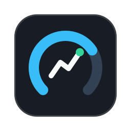
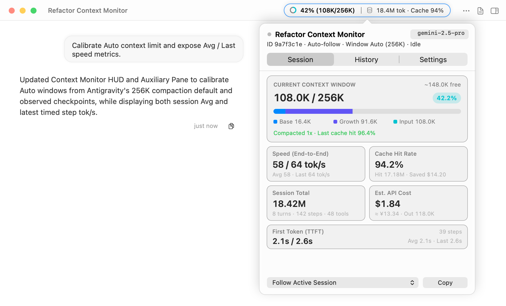
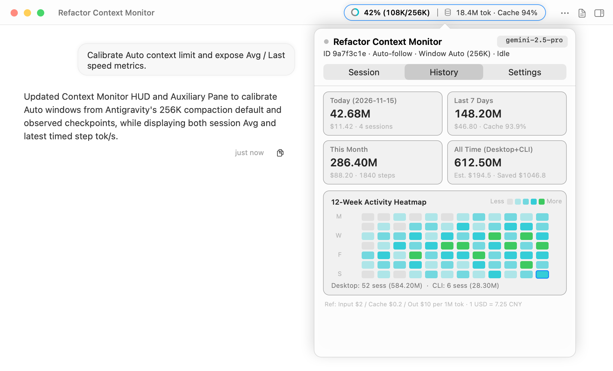
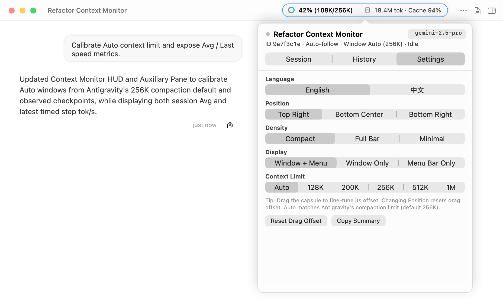
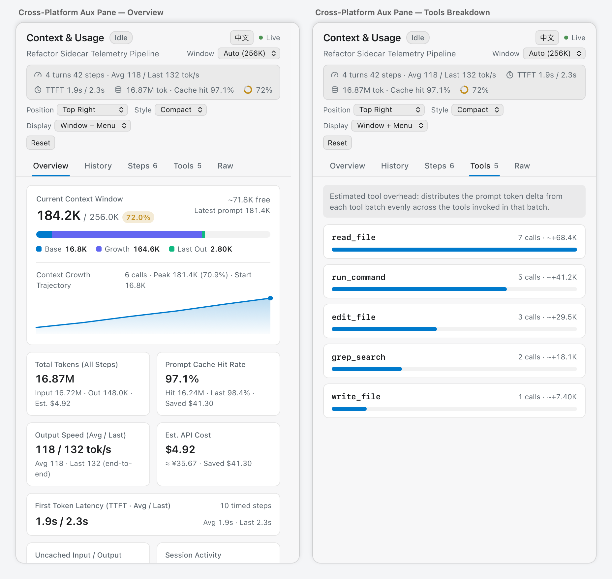
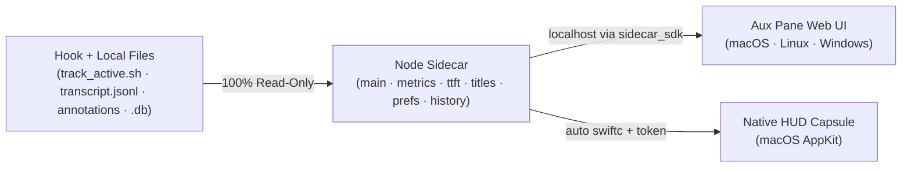

<div align="center">
  
  <h1>Context &amp; Usage Monitor</h1>
  <p><strong>A 100% read-only, zero-injection plugin for Google Antigravity (Desktop &amp; CLI) — live context pressure, Prompt Cache savings, output speed (<code>tok/s</code>), First Token Latency (<code>TTFT</code>), and a 12-week heatmap.</strong></p>

  <p>
    
    
    
    
    <a href="./LICENSE"></a>
  </p>

  <p><strong>English</strong> | <a href="./README.zh-CN.md">简体中文</a></p>
</div>

---

## Why This Plugin?

- **No more surprise `256K` compactions**: Most flagship models auto-compact near `256K` (`CHECKPOINT`), not `1M`. **`Auto` mode calibrates directly to `256K` by default** and adapts via observed `CHECKPOINT` peaks and model hints, so you know right when to `/compact`.
- **See what bloated your context**: Splits usage into **Base** vs. **Growth** tokens and attributes per-turn and per-tool (`read_file`, `run_command`, etc.) deltas.
- **Know if it's thinking or lagging**: Tracks both session average and latest-step **First Token Latency (`Avg / Last TTFT`)** alongside **End-to-End Output Speed (`Avg / Last tok/s`)**.
- **Track Cache savings & total usage**: Shows live Prompt Cache hit rate, reference API cost/savings (`USD` / `CNY`), and an **84-day activity heatmap** combining **Antigravity Desktop + CLI**.
- **Zero app mods, zero risk**: Pure official plugin — `0` extra prompt tokens, Apple code signatures stay intact, and survives every Antigravity client update.

---

## Preview

<p align="center">
  
  <br />
  <sub><strong>macOS Titlebar Capsule &amp; Session Popover</strong> — <code>Auto (256K)</code> gauge, Base/Growth breakdown, <code>Avg / Last tok/s</code>, <code>Avg / Last TTFT</code>, and session switcher</sub>
</p>

<table>
  <tr>
    <td width="50%" align="center">
      
      <br />
      <sub><strong>Global History &amp; 12-Week Heatmap</strong> — Desktop + CLI totals</sub>
    </td>
    <td width="50%" align="center">
      
      <br />
      <sub><strong>Instant Settings</strong> — <code>English / 中文</code>, position, density &amp; limit</sub>
    </td>
  </tr>
</table>

<p align="center">
  
  <br />
  <sub><strong>Cross-Platform Auxiliary Pane Web UI</strong> — Overview (with <code>TTFT</code> &amp; Speed cards), History, Steps, Tools, and Raw</sub>
</p>

> **Two ways to inspect**: On macOS, left-click the floating titlebar capsule to open the 3-tab popover (right-click for quick controls, drag to reposition). On **all platforms**, click **`+` → Context & Usage** in any conversation header to open the Auxiliary Pane.

---

## Quick Install

```bash
git clone https://github.com/heywalter/antigravity-context-monitor.git \
  ~/.gemini/config/plugins/context-monitor
```

Restart Antigravity (or enable **Context & Usage** in **Customizations**), or validate/install via CLI (`agy plugin validate . && agy plugin install .`). On macOS, `hud_bar.swift` auto-compiles locally on first launch when `swiftc` (Xcode Command Line Tools) is installed, or skips the floating HUD cleanly while keeping the Aux Pane active.

---

## How It Works, Security & Compatibility



- **100% Within Official Rules**: Uses only Antigravity's official [`plugin.json`](./plugin.json), [`hooks.json`](./hooks.json), and `sidecar_sdk` ([`sidecar.json`](./sidecars/context_monitor/sidecar.json) with `"allows_user_interactions": false`); passes `agy plugin validate` with **0 errors and 0 warnings**, and never edits `config.json`.
- **Pure Local Read-Only Logic**: A minimal `SessionStart` / `PreInvocation` hook records `active_hook.json`; the sidecar reads Antigravity's own `transcript.jsonl` (tokens, checkpoints, speed), `annotations/*.pbtxt` (live & renamed titles), and read-only SQLite `conversations/*.db` (`created_at` → `viewable_at` TTFT), calibrating `Auto` limits via `256K` default, `CHECKPOINT` peaks, model hints, and overflow promotion.
- **Security & Privacy**: Zero `Antigravity.app` patching, zero CDP (`--remote-debugging-port`), **zero outbound network requests** (`127.0.0.1` only), per-launch random `CONTEXT_MONITOR_HUD_TOKEN` protecting `/api/hud`, strict `ID_RE` path-traversal checks, and `{ readOnly: true }` SQLite handles ([SECURITY.md](./SECURITY.md)).
- **Cross-Platform & Graceful Fallback**: Full Aux Pane UI runs on **macOS, Linux, and Windows** (`hudSupported === false` auto-hides Mac controls); macOS adds the native `arm64`/`x86_64` HUD (skips safely if `swiftc` is absent); on Node 20 without `node:sqlite`, `TTFT` falls back cleanly to `—` with zero errors; survives Antigravity app updates intact.

---

## Notes & Development

- **Telemetry & Reference Cost**: Token counts are 100% raw Antigravity telemetry from `transcript.jsonl`; `TTFT` measures request start to first visible output chunk (including extended thinking). USD/CNY estimates use a static benchmark (`Input $2 / Cache $0.2 / Out $10 per 1M`, `1 USD = 7.25 CNY`) for reference intuition only.

<details>
<summary>Development &amp; Verification Commands (zero external npm dependencies)</summary>

```bash
# 1. Check hook & JS syntax
sh -n hooks/track_active.sh
cd sidecars/context_monitor
node --check main.mjs && node --check prefs.mjs && node --check titles.mjs && node --check ttft.mjs && node --check metrics.mjs && node --check history.mjs && node --check app.js

# 2. Run unit tests & validate manifests
npm test
cd ../.. && agy plugin validate .

# 3. Build & self-test macOS Universal Binary (arm64 + x86_64)
./scripts/build-hud-universal.sh && rm -rf dist
```

Runtime data lives under `~/.gemini/antigravity/sidecar_data/context-monitor/context_monitor/` (`logs/sidecar.log`, `data/hud_prefs.json`, `data/bin/hud_bar`).

</details>

[CONTRIBUTING.md](./CONTRIBUTING.md) · [SECURITY.md](./SECURITY.md) · [CHANGELOG.md](./CHANGELOG.md) · [MIT](./LICENSE) © 2026 Walter
