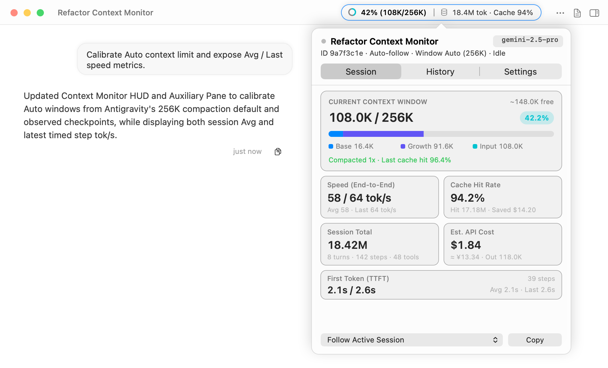
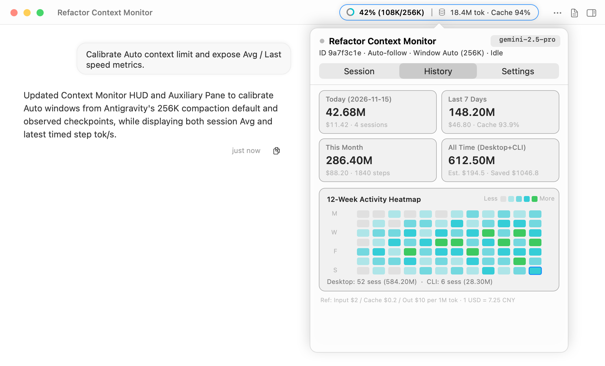
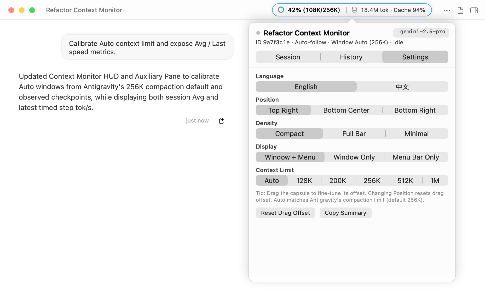
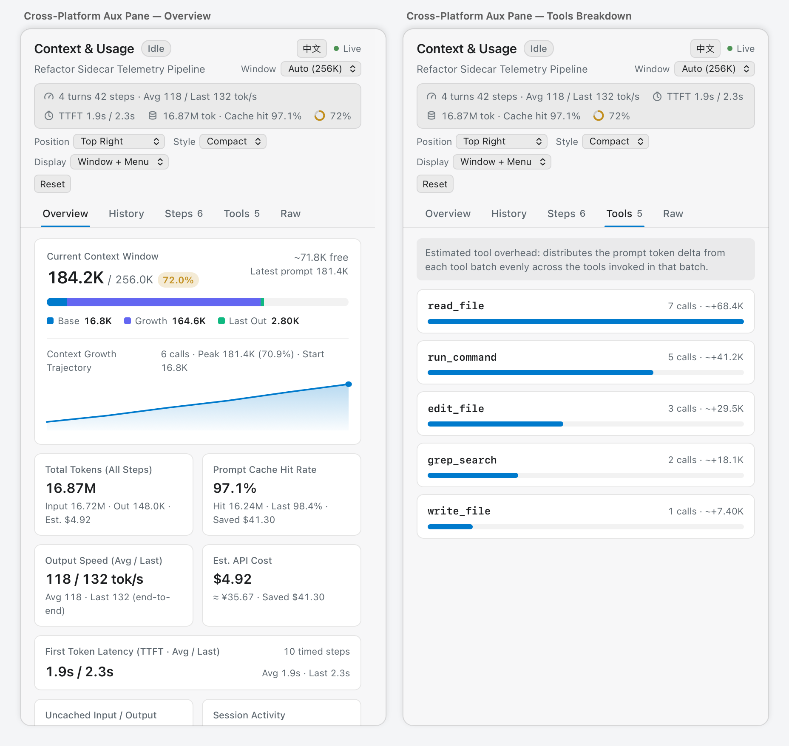
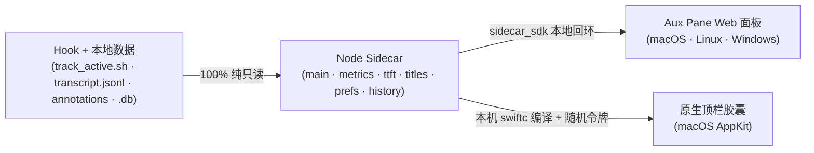

<div align="center">
  
  <h1>Antigravity Context &amp; Usage Monitor</h1>
  <p><strong>面向 Google Antigravity（Desktop &amp; CLI）的 100% 纯只读、零注入监控插件 —— 实时显示上下文水位、Prompt Cache 省钱、输出速率（<code>tok/s</code>）、首字时间（<code>TTFT</code>）与 12 周热力图。</strong></p>

  <p>
    
    
    
    
    <a href="./LICENSE"></a>
  </p>

  <p><a href="./README.md">English</a> | <strong>简体中文</strong></p>
</div>

---

## 为什么需要它？

- **告别 `256K` 突然压缩失忆**：主力模型多在 `256K` 左右自动压缩（`CHECKPOINT`）而非 `1M`。插件 **`Auto` 模式默认按 `256K` 校准**，并结合实测压缩峰值与模型动态修正，提示你何时该执行 `/compact`。
- **一眼看清谁吃掉了上下文**：拆解 **初始基线（Base）** 与 **对话增量（Growth）**，精准定位每一轮和每个工具（`read_file`、`run_command` 等）带来了多少开销。
- **分清“深度思考”还是“输出卡顿”**：并排展示会话平均与末步 **首字延迟（`Avg / Last TTFT`）** 和 **端到端生成速率（`Avg / Last tok/s`）**，长思考与输出慢一目了然。
- **算清 Cache 省钱与跨端总量**：实时统计 Prompt Cache 命中率、等效参考费用/省钱额（`USD` / `CNY`），并用 **12 周热力图** 汇总 **Desktop + CLI** 全量消耗。
- **不改客户端、零安全风险**：纯正官方插件架构 —— **0 额外提示词**、不破坏苹果代码签名，客户端升级照常可用。

---

## 界面预览

<p align="center">
  
  <br />
  <sub><strong>macOS 顶栏胶囊与 Session 弹窗</strong> — <code>Auto (256K)</code> 水位、基线/增量拆解、<code>Avg / Last tok/s</code>、<code>Avg / Last TTFT</code> 与会话切换</sub>
</p>

<table>
  <tr>
    <td width="50%" align="center">
      
      <br />
      <sub><strong>全局看板 &amp; 12 周热力图</strong> — 自动聚合 Desktop 与 CLI</sub>
    </td>
    <td width="50%" align="center">
      
      <br />
      <sub><strong>即时设置</strong> — <code>English / 中文</code>、位置、紧凑度与上限</sub>
    </td>
  </tr>
</table>

<p align="center">
  
  <br />
  <sub><strong>全平台 Auxiliary Pane Web 面板</strong> — 概览（含 <code>TTFT</code> 与速率卡片）、全局看板、步骤、工具拆解与 Raw</sub>
</p>

> **两种查看方式**：macOS 下左键点击顶栏胶囊展开 3-Tab 弹窗（右键快捷设置，按住可拖拽微调）；**所有系统**均可在任意对话右上角点击 **`+` → Context & Usage** 打开侧边 Aux Pane 完整面板。

---

## 快速安装

```bash
git clone https://github.com/heywalter/antigravity-context-monitor.git \
  ~/.gemini/config/plugins/context-monitor
```

重启 Antigravity（或在 **Customizations** 启用 **Context & Usage**），也可使用 CLI 校验安装（`agy plugin validate . && agy plugin install .`）。macOS 首次启动会自动调用本机 `swiftc`（Xcode Command Line Tools）编译顶栏胶囊；若未安装 `swiftc` 则自动跳过胶囊，保留完整的 Aux Pane 面板。

---

## 实现原理、安全与兼容性



- **完全处于官方规则允许范围内**：仅使用官方 [`plugin.json`](./plugin.json)、[`hooks.json`](./hooks.json) 与 `sidecar_sdk`（[`sidecar.json`](./sidecars/context_monitor/sidecar.json) 声明 `"allows_user_interactions": false`），通过 `agy plugin validate` **0 报错 0 警告**，绝不修改 `config.json` 或调用受限内部 RPC。
- **纯本地只读逻辑**：轻量 Hook 仅原子记录活跃会话 `active_hook.json`；Sidecar 只读解析 Antigravity 原生的 `transcript.jsonl`（Token/压缩/速率）、`annotations/*.pbtxt`（最新与重命名标题）以及 SQLite `conversations/*.db`（`created_at` → `viewable_at` 首字延迟），并通过 `256K` 默认 + `CHECKPOINT` 峰值 + 模型识别自动校准上限。
- **安全性保障**：绝不修改 `/Applications/Antigravity.app` 二进制，不开 `--remote-debugging-port` CDP 调试端口，**零外部联网外发**（仅限 `127.0.0.1`），每次启动生成随机 `CONTEXT_MONITOR_HUD_TOKEN` 保护 `/api/hud`，严格校验 `ID_RE` 防路径穿越且 SQLite 强制 `{ readOnly: true }`（详见 [SECURITY.md](./SECURITY.md)）。
- **跨平台兼容与优雅降级**：**macOS / Linux / Windows** 均完整支持 Aux Pane（非 Mac 自动隐藏胶囊控件）；macOS 自动适配 Apple Silicon / Intel（无 `swiftc` 自动跳过 HUD）；在无 `node:sqlite` 的 Node 20 下 `TTFT` 安全显示为 `—` 不报错；客户端升级无需任何重装或补丁。

---

## 数据说明与本地开发

- **数据与费用口径**：Token 数量 100% 来自 Antigravity 原生 `transcript.jsonl`；`TTFT` 统计请求发出至首段可见输出的时间（含思考等待）。美元/人民币仅按参考 API 单价换算（`Input $2 / Cache $0.2 / Out $10 per 1M`，`1 USD = 7.25 CNY`），用于体感对比。

<details>
<summary>本地开发与校验命令（零第三方 npm 依赖）</summary>

```bash
# 1. Hook 与 JS 语法检查
sh -n hooks/track_active.sh
cd sidecars/context_monitor
node --check main.mjs && node --check prefs.mjs && node --check titles.mjs && node --check ttft.mjs && node --check metrics.mjs && node --check history.mjs && node --check app.js

# 2. 单元测试与官方清单校验
npm test
cd ../.. && agy plugin validate .

# 3. 编译并自检 macOS 通用二进制 (arm64 + x86_64)
./scripts/build-hud-universal.sh && rm -rf dist
```

运行时数据位于 `~/.gemini/antigravity/sidecar_data/context-monitor/context_monitor/`（`logs/sidecar.log`、`data/hud_prefs.json`、`data/bin/hud_bar`）。

</details>

[CONTRIBUTING.md](./CONTRIBUTING.md) · [SECURITY.md](./SECURITY.md) · [CHANGELOG.md](./CHANGELOG.md) · [MIT](./LICENSE) © 2026 Walter
